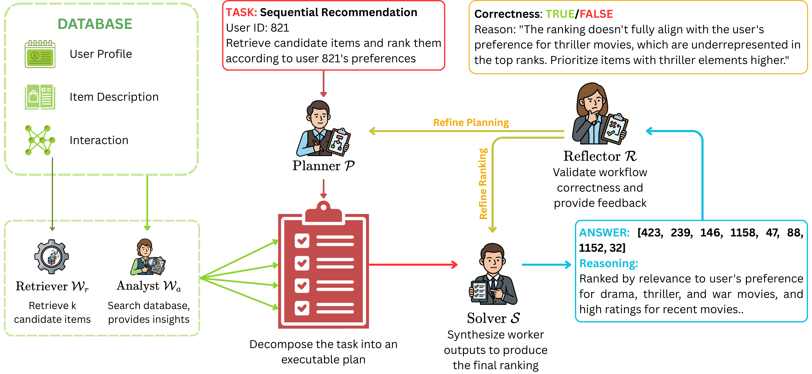

<h1 align="center">MARCO</h1>

<p align="center">
  Multi-agent pipelines for recommendation and reranking.
</p>

<div align="center">

[](#installation) [](requirements.txt) [](requirements.txt) [](LICENSE)

[](#quick-start) [](#configuration) [](#evaluation) [](https://github.com/L2R-UET/MARCO)

</div>

## Overview

MARCO runs configurable multi-agent pipelines for **sequential recommendation** and **rating prediction**. A Planner coordinates retrieval and analysis, a Solver produces the final prediction or ranking, and an optional Reflector provides feedback for refinement. Each role has its own model and generation settings.

[](figs/workflow.pdf)

*The Retriever supplies candidates, the Analyst gathers user/item evidence, and the Solver synthesizes the ranking. The optional Reflector reviews the trajectory and provides focused feedback. Click the figure for the original PDF.*

| Component | Responsibility |
| --- | --- |
| Planner | Decompose the request into a dependency-aware execution plan |
| Retriever | Expose the candidate items supplied with the input |
| Analyst | Retrieve user/item information and interaction histories |
| Solver | Combine the plan and evidence into a final prediction or ranking |
| Reflector | Review the trajectory and request focused refinement |

Tasks are sequential recommendation (`sr`) and rating prediction (`rp`). Dataset identifiers are `ml-100k`, `Beauty`, `Electronics`, and `Yelp2020`. The single-agent alternative uses `--system single --system_config config/systems/single/basic.json`.

This repository accompanies *Fewer Tokens, Smaller Agents: Role-Aware Allocation for Efficient Multi-Agent Recommendation*, accepted at SOICT 2026.

## Installation

Run commands from the repository root unless a helper script is used.

```bash
git clone https://github.com/L2R-UET/MARCO.git
cd MARCO
conda create -n MARCO python=3.10.22
conda activate MARCO
```

**Choose one PyTorch build**, then install the remaining dependencies. The pinned baseline is Torch 2.7.1; the version badges identify the documented baseline, not compatibility with every newer release.

```bash
# CPU
python -m pip install torch==2.7.1+cpu --extra-index-url https://download.pytorch.org/whl/cpu

# Or NVIDIA CUDA 12.8, with a compatible GPU and driver
# python -m pip install torch==2.7.1+cu128 --extra-index-url https://download.pytorch.org/whl/cu128

python -m pip install -r requirements.txt
python -m pip check
```

[requirements.txt](requirements.txt) keeps the legacy `langchain.prompts` interface and constrains the model SDKs. The ordinary dependency install does not change the PyTorch index or replace a matching CPU/CUDA build.

Create a private API configuration from the safe [example](config/api-config-example.json):

```bash
# Bash
cp config/api-config-example.json config/api-config.json
```

```powershell
# PowerShell
Copy-Item config/api-config-example.json config/api-config.json
```

Configure **only the providers you use**. All default MARCO roles use Vertex AI: fill `providers.vertexai` with either an API key, or your project and service-account/ADC setup. A nonempty Vertex `api_key` takes precedence over `project_id` and `credentials_path`. For project authentication, leave `api_key` empty, replace the example project ID, and supply your credentials file or Application Default Credentials. The default configuration needs no local inference server. Credentials and service-account files must remain private.

## Data preparation

Prepare data before running commands that expect `test.csv`. The default helper processes **MovieLens-100K only** and downloads its raw archive if absent:

```bash
bash scripts/preprocess.sh
```

Equivalent Python command, usable from Bash or PowerShell:

```bash
python main.py --main Preprocess --data_dir data/ml-100k --dataset ml-100k --n_neg_items 9
```

The loader creates `data/ml-100k/test.csv`, `all.csv`, `user.csv`, `item.csv`, and ID-mapping CSVs. Evaluation requires the test file and the companion information/interaction files in that directory. The supplied preprocessing path samples nine negatives per held-out item; recommender-generated candidates are an optional separate input path.

| Dataset | Raw source and selection | Optional helper |
| --- | --- | --- |
| MovieLens-100K | [GroupLens 100K archive](https://grouplens.org/datasets/movielens/100k/) | `bash scripts/preprocess.sh ml-100k` |
| Amazon Beauty / Electronics | [Stanford Amazon reviews (2014)](https://snap.stanford.edu/data/amazon/): `reviews_CATEGORY_5.json.gz` and `meta_CATEGORY.json.gz` | `bash scripts/preprocess.sh Beauty` or `Electronics` |
| Yelp (`Yelp2020`) | [Yelp archive on Kaggle](https://www.kaggle.com/datasets/yelp-dataset/yelp-dataset); the current loader selects reviews using its 2019 date bounds | `bash scripts/preprocess.sh Yelp2020` |

Amazon loaders write under `data/Beauty/` or `data/Electronics/` and create `item.csv`, `all.csv`, `test.csv`, and mappings. They do not require a user-profile CSV. For Yelp, manually place `archive.zip` or `dataset.tgz` in `data/Yelp2020/raw_data/` before preprocessing; the archive snapshot is not pinned by this repository. Dataset preparation may be expensive, so optional datasets are never processed implicitly by the helper.

## Quick start

After API setup and MovieLens preprocessing, evaluate five rows with the basic Planner–Analyst–Solver system:

```bash
python main.py --main Test --data_file data/ml-100k/test.csv --system marco --system_config config/systems/marco/basic.json --task sr --samples 5
```

This **makes model requests**, can incur provider charges, and writes logs and JSON results. `Test` evaluates a subset of the supplied CSV; it is not an offline unit test. It selects the first five rows by default. `--random`, `--last`, and the offsets in `python main.py --main Test --help` provide other selections.

## Evaluation

`Evaluate` processes the provided input CSV; it does not select an original benchmark or regenerate a split automatically.

```bash
python main.py --main Evaluate --data_file data/ml-100k/test.csv --system marco --system_config config/systems/marco/basic.json --task sr --topks '[1,3,5]'
```

The helper invokes one configuration and reports the selected input before execution:

```bash
bash scripts/evaluate.sh data/ml-100k/test.csv config/systems/marco/basic.json sr --topks '[1,3,5]'
```

With no arguments it uses that input, basic configuration, and `sr`. All helpers resolve paths from the repository root, accept extra CLI options after their positional arguments, and support `--help`. Set `PYTHON` to select another interpreter.

For sequential recommendation, **HR@K** measures whether the held-out item appears in the first K positions; **NDCG@K** additionally discounts a hit at a lower rank. With one relevant item, HR@K equals Recall@K. For `rp`, the evaluator reports RMSE, MAE, and exact-match rating accuracy.

- **`true_*` ranking metrics** include every processed sample in the denominator, including unfinished runs and rows whose ground truth is absent from the candidate list. Those absent-ground-truth rows skip model generation and score zero. Unfinished runs retain the scoring of their returned answer; an empty or string ranking scores zero.
- **`valid_*` metrics** include only samples with `system.finished == True`; a finished response need not be correct. Compare them with the reported valid/total counts, system failures, and skipped-ground-truth counts.
- `--topks '[1,3,5,10]'` selects other cutoffs. The existing evaluator also adds K=10 when it detects at least 15 candidates and the default `[1,3,5]` cutoffs are in use. `--steps` controls outer generation steps; it is distinct from an agent's turn limit and the system's workflow budget.

## Reflection

Use the Reflector-enabled system to add review while keeping the same core agents:

```bash
python main.py --main Test --data_file data/ml-100k/test.csv --system marco --system_config config/systems/marco/reflector.json --task sr --samples 5
```

The CLI enables automatic feedback-driven reruns by default. Planner feedback can rerun Plan–Work–Solve; Solver-only feedback can rerank using existing evidence. The implementation allows one feedback-driven refinement cycle per sample. Append `--disable-reflection-rerun` to skip the automatic review/refinement path; the Reflector remains in the configuration. `keep_reflections: true` retains its feedback in the agent's reflection history.

## Configuration

The default configuration uses Vertex AI for each role:

| Role | Provider | Model | Max output tokens | Max turns | JSON mode |
| --- | --- | --- | ---: | ---: | --- |
| Planner | `vertexai` | `gemini-2.5-flash-lite` | 2,048 | 5 | No |
| Analyst | `vertexai` | `gemini-2.5-flash-lite` | 2,048 | 12 | Yes |
| Solver | `vertexai` | `gemini-2.5-pro` | 12,000 | 5 | Yes |
| Reflector (optional) | `vertexai` | `gemini-2.5-flash` | 10,000 | — | Yes |

All four use temperature **0**. Edit individual files under [config/agents/](config/agents/) to change a role's provider, model, generation limits, or JSON mode. The basic and reflector system JSONs in [config/systems/marco/](config/systems/marco/) select agents/prompts and both retain `max_step: 15`. Analyst tool paths substitute `{dataset}` to load the corresponding [information](config/tools/info_database/) and [interaction](config/tools/interaction/) configuration. The input directory name supplies the dataset identifier unless `--dataset` overrides it; companion paths in the tool JSONs remain relative to the repository root.

**Global overrides are separate from JSON defaults.** Supplying `--provider` selects its CLI-default model unless `--model` is also supplied. Both replace the provider/model of eligible agents, including agents configured with `ollama`; only the literal legacy provider `opensource` is excluded by the current implementation. `--model` alone does not activate an override. This behavior is preserved in [marco/systems/base.py](marco/systems/base.py).

`--max_his 10` keeps the ten most recent interactions in formatted prompts; `--max_his 0` or a negative value removes that prompt-history limit. Planner and Analyst reuse successful responses in `cached/`. `--no_cache` disables their cache reads but still writes successful uncached responses; it does not disable all filesystem writes or apply a global cache policy to every agent.

## Outputs

Logs go to `logs/` and JSON results to `results/`, named approximately `{task}_{dataset}_{system}_{samples}_{timestamp}` with `.log` or `.json`. Generated outputs and caches are ignored by Git.

| JSON field | Contents |
| --- | --- |
| `run_info`, `data` | Effective arguments, input path, task/system, timestamps, and output locations |
| `agents` | Agent/model inventory and usage details |
| `samples` | Ground truth, final answers, prompts, input records, completion state, and available Solver/reflection attempts |
| `evaluation` | Metrics, valid/total counts, failed and skipped samples, and cumulative score snapshots |
| `reflection` | Refinement/rerun summaries |
| `token_stats`, `duration_stats` | Aggregate and per-agent token/API usage and time |

Results contain input records and prompts; inspect them before sharing.

## Advanced usage

<details>
<summary><strong>Other providers and local inference</strong></summary>

Supported provider IDs are `vertexai`, `gemini`, `openai`, `openrouter`, `codexhub`, `ollama`, and `huggingface`. Their credential fields and endpoint examples live in [config/api-config-example.json](config/api-config-example.json). API access and model availability depend on the provider.

For example, to override eligible roles through the OpenAI adapter:

```bash
python main.py --main Test --data_file data/ml-100k/test.csv --system marco --system_config config/systems/marco/basic.json --task sr --samples 5 --provider openai --model gpt-4o-mini
```

For a local Ollama role, install [Ollama](https://ollama.com/), run `ollama serve`, pull the intended model (for example `ollama pull llama3.2:3b`), and set that role's JSON provider/model to `ollama` / `llama3.2:3b`. The adapter uses the configured Ollama endpoint, normally `http://localhost:11434`. A global Ollama override instead changes all eligible roles. Hugging Face inference loads local model weights through Transformers and Accelerate; configure the token for gated models and provide enough memory for the chosen model.

</details>

<details>
<summary><strong>Vertex AI batch prediction</strong></summary>

Batch runs require project authentication, GCS access, and a writable bucket. They submit real jobs. For MARCO, the implementation batches eligible Vertex AI Solver/Reflector stages while coordinating the other stages online; the single-agent system batches full prompts.

```bash
python main.py --main Test --data_file data/ml-100k/test.csv --system marco --system_config config/systems/marco/reflector.json --task sr --samples 5 --batch --batch_gcs_uri_prefix gs://your-bucket/marco-batch/run-001
```

Replace the bucket/prefix with your own. `--batch_gcs_uri_input` reuses an existing GCS JSONL input only for single-system batch runs; it is not accepted for MARCO batch orchestration. Batch behavior and metrics are separate from online runs.

</details>

<details>
<summary><strong>Recommender training and candidate export</strong></summary>

The existing LightGCN, SASRec, and BERT4Rec implementations train using their current positive-rating filter and leave-one-out split. Training is optional for the five-row example above. To train one selected model and export top-20 candidates aligned with an existing MARCO test CSV:

```bash
bash scripts/training.sh sasrec data/ml-100k/all.csv data/ml-100k/test.csv
```

Equivalent Python invocation:

```bash
python -m recommender.run --model sasrec --data data/ml-100k/all.csv --test_data data/ml-100k/test.csv --epochs 200 --batch_size 256 --lr 0.001 --export_topk 20
```

`--test_data` selects the rows for candidate export; it does not replace the training split. Without it, the Python CLI uses its internal held-out test rows. The helper supplies it explicitly for the documented export path. Models are `lightgcn`, `sasrec`, and `bert4rec`; append `--device cpu` or `--device cuda` to select a device.

Checkpoints are written to `recommender/checkpoints/MODEL_DATASET.pth`, logs to `recommender/logs/`, and candidate CSVs to `data/DATASET/test_MODEL.csv`. The current export code writes under `data/` even though the CLI also has a `--candidate_dir` option. Point `--data_file` at the exported CSV for subsequent reranking and retain its companion dataset files. Training and export do not guarantee that each ground-truth item is in the retrieved candidates; the evaluator's failure accounting still applies.

</details>

## License

Project code is available under the [MIT License](LICENSE), copyright © 2026 MARCO contributors. Dependencies, external datasets, and model resources retain their own licenses and terms.
